# Analiza danych F1: co zrobiliśmy i co wyszło

← [Wnioski](Wnioski.md) · [raport HTML](../Raport/raport_analizy_F1.html) · [notebook](../notebooks/Analiza%20korelacji%20parametrow%20F1%20-%20pelna.ipynb)

Analiza zgodna z wykładem „Eksploracyjna analiza danych” (ZSSI): typy atrybutów → jakość danych → statystyki → atrybuty jakościowe → rozkłady → przebieg w czasie → korelacje → wnioski.

## 1. Dane

**Źródło:** [TracingInsights-Archive/2025](https://github.com/TracingInsights-Archive/2025), surowe JSON-y. **Zakres:** 2 tory, tylko wyścigi. Jeden wiersz to jedno okrążenie jednego kierowcy: pomiar czasu, opony, pozycja, pogoda i agregaty telemetrii z tego okrążenia.

| Tor | okrążenia | kierowcy | długość wyścigu | czyste okrążenia | pit stopy | okrążenia SC/VSC |
|---|---:|---:|---:|---:|---:|---:|
| Austrian GP | 1127 | 20 | 70 | 984 | 33 | 54 |
| Azerbaijan GP | 968 | 20 | 51 | 791 | 21 | 77 |

**Czyste okrążenie:** zielona flaga, bez 1. okrążenia, bez wjazdu i wyjazdu z boksu, nieusunięte, czas < 107% mediany. Na takich okrążeniach liczymy główne korelacje.

**Parametry (35 liczbowych w analizie):**
- czasy: okrążenie i 3 sektory;
- pułapki prędkości: I1, I2, FL, ST;
- przebieg wyścigu: okrążenie, stint, wiek opony, pozycja;
- pogoda: temperatura toru i powietrza, wilgotność, ciśnienie, wiatr;
- telemetria (agregat z okrążenia): prędkość średnia, maksymalna i w zakrętach; gaz, hamulec, biegi, obroty; DRS; przyspieszenia; jazda za rywalem.

## 2. Jakość danych

| Kontrola | Wynik |
|---|---|
| Duplikaty (całe wiersze, klucz tor-kierowca-okrążenie, telemetria) | **0** |
| Braki | tylko tam, gdzie wynikają z definicji (`PitInTime`/`PitOutTime` poza zjazdem, odstęp do auta z przodu u lidera) + pojedyncze pomiary sektora 1 (~2%) i pułapki FL (~3%) |
| Błędne dane (reguły dziedzinowe: czas ≤ 0, suma sektorów ≠ czas, prędkość > 380 km/h, temperatury, pozycja…) | **1** okrążenie: średni gaz poza 0–100% (Austria) |
| Wartości odstające (1.5·IQR) | na czystych okrążeniach zwykle < 2%; na wszystkich do ~12%, głównie przez SC/VSC i pit stopy |

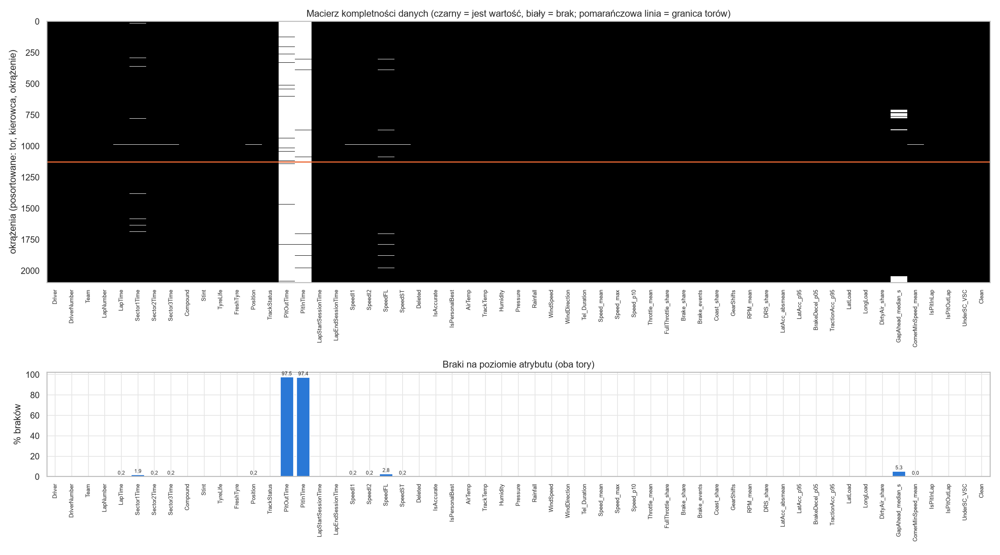
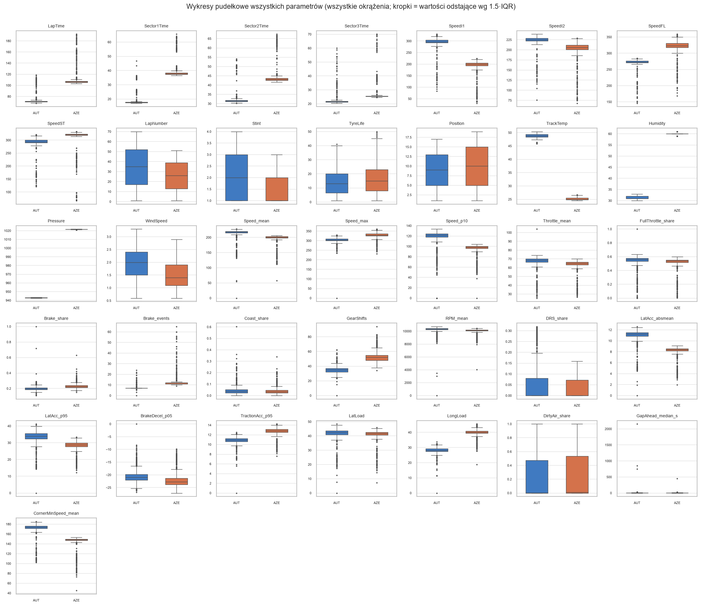

## 3. Atrybuty jakościowe i niezbalansowanie

**IR** (imbalance ratio) = liczność klasy większościowej / mniejszościowej.

| Tor | kategoria | większościowa | mniejszościowa | IR |
|---|---|---|---|---:|
| Austria | mieszanka | MEDIUM (611) | SOFT (74) | 8.3 |
| Austria | okrążenie z pit stopem | bez pit (1094) | pit (33) | **33.2** |
| Austria | zielona flaga vs SC/VSC | normalnie (1073) | SC/VSC (54) | 19.9 |
| Baku | mieszanka | HARD (598) | MEDIUM (370) | 1.6 |
| Baku | okrążenie z pit stopem | bez pit (947) | pit (21) | **45.1** |
| Baku | zielona flaga vs SC/VSC | normalnie (891) | SC/VSC (77) | 11.6 |

W Baku nikt nie jechał na SOFT.

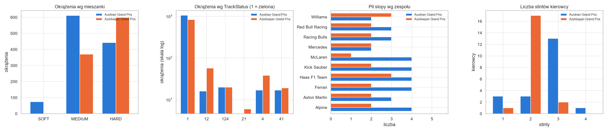
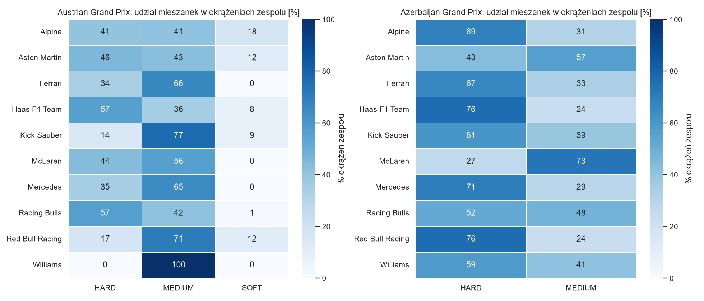

## 4. Rozkłady

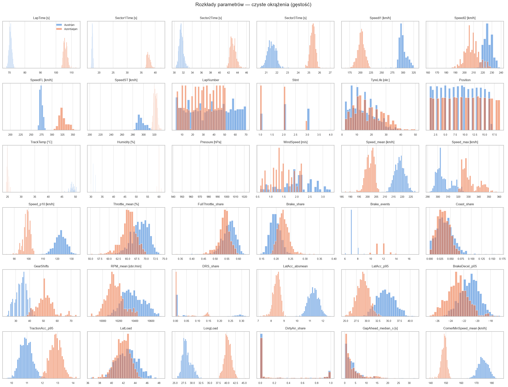
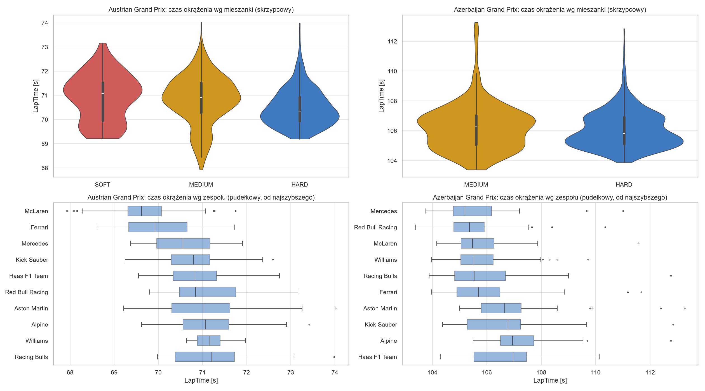

## 5. Przebieg wyścigu

Tempo czołowej piątki, zmiany pozycji i temperatura w kolejnych okrążeniach. Pomarańczowe tło oznacza Safety Car / VSC.

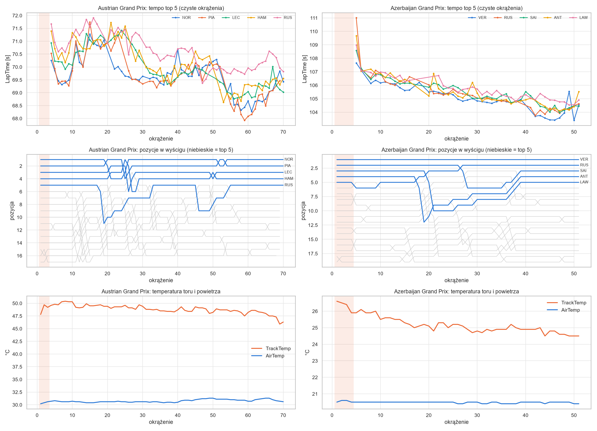

## 6. Korelacje

Liczyliśmy Pearsona, Spearmana i korelację odległości (wykrywa też zależności nieliniowe). Każdą korelację sprawdzaliśmy dodatkowo **w obrębie jednego kierowcy** (usuwa różnice między bolidami) i **po usunięciu numeru okrążenia** (usuwa wspólny trend wyścigu). Pary oczywiste z definicji, np. czas okrążenia = suma sektorów, są wyłączone z rankingu.

**Najsilniejsze zależności (ρ Spearmana, czyste okrążenia):**

| parametr A | parametr B | Austria | Baku | Austria, w obrębie kierowcy | Baku, w obrębie kierowcy |
|---|---|---:|---:|---:|---:|
| LapTime | CornerMinSpeed_mean | −0.90 | −0.86 | −0.89 | −0.91 |
| LapNumber | TrackTemp | −0.87 | −0.86 | −0.83 | −0.88 |
| Sector2Time | CornerMinSpeed_mean | −0.85 | −0.82 | −0.83 | −0.88 |
| DRS_share | DirtyAir_share | 0.78 | 0.80 | 0.84 | 0.85 |
| LapTime | LatAcc_absmean | −0.90 | −0.77 | −0.88 | −0.77 |
| Speed_max | DRS_share | 0.75 | 0.78 | 0.87 | 0.84 |
| Sector1Time | SpeedI1 | −0.68 | −0.77 | −0.64 | −0.78 |
| Sector2Time | SpeedI2 | −0.68 | −0.71 | −0.60 | −0.75 |
| LapTime | SpeedI2 | −0.70 | −0.68 | −0.62 | −0.69 |
| LapNumber | Pressure | −0.95 | **+0.66** | −0.95 | +0.66 |

Ostatni wiersz pokazuje parę, która zmienia znak między torami. Pełna lista 630 par jest w `pair_ranking.csv` (generuje ją notebook; CSV nie trzymamy w repozytorium).

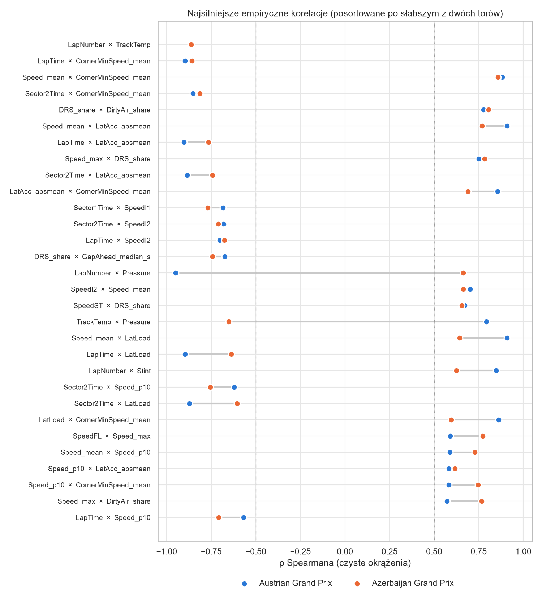
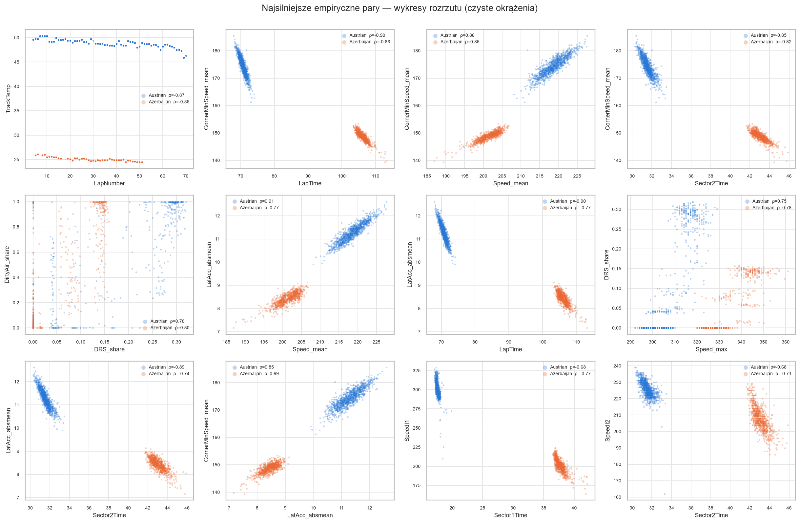
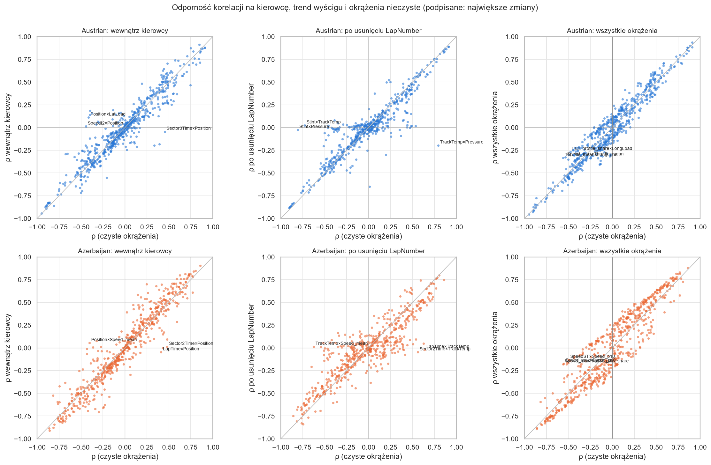
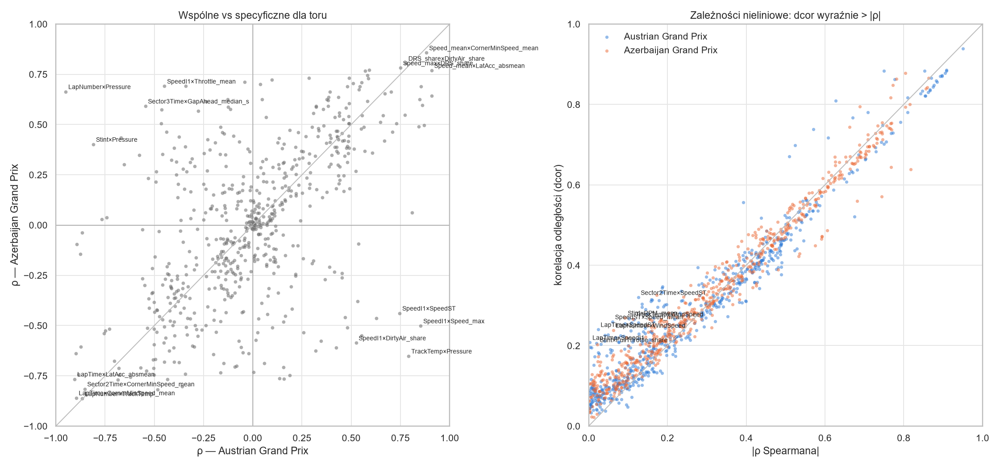

Macierze wszystkich parametrów: 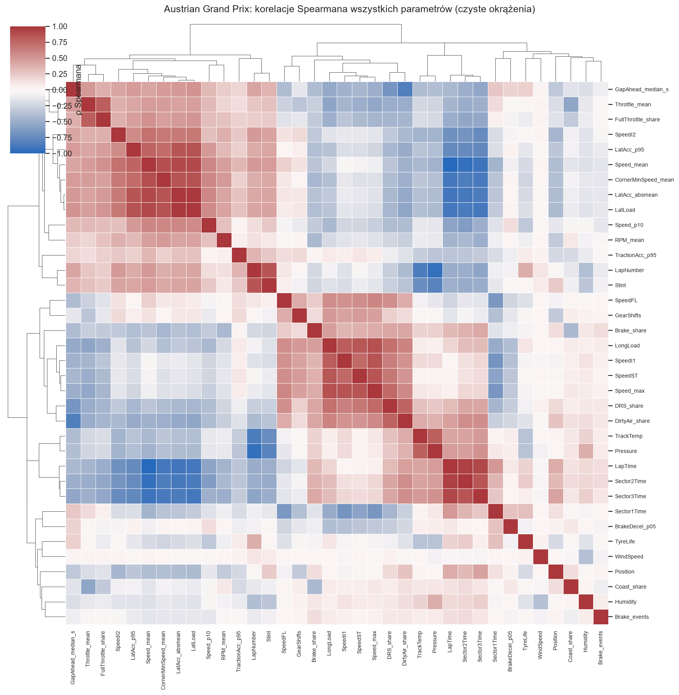 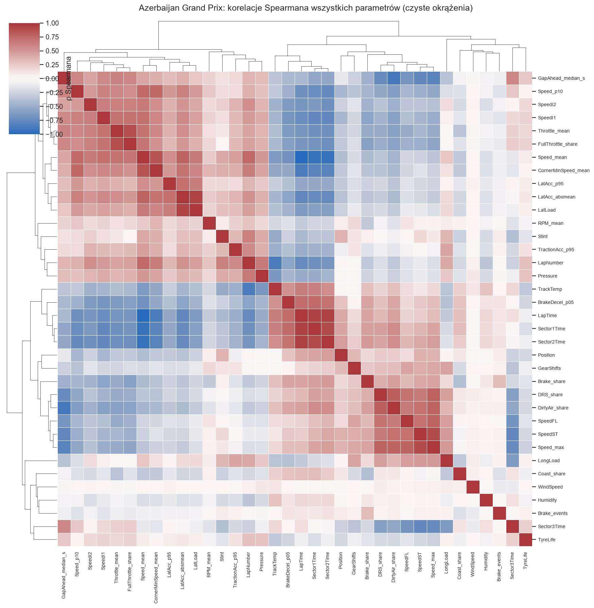

## 7. Kategorie a parametry (η²)

η² mówi, jaką część zmienności parametru wyjaśnia kategoria (0 = nic, 1 = wszystko).

| co wyjaśnia czas okrążenia | Austria | Baku |
|---|---:|---:|
| TrackStatus (SC/VSC), wszystkie okrążenia | **0.82** | **0.96** |
| Kierowca | 0.33 | 0.20 |
| Zespół | 0.31 | 0.18 |
| Mieszanka | 0.03 | 0.00 |

Parametry wyjaśniane głównie przez kierowcę: pozycja (0.84 / 0.89), liczba zmian biegów (0.67 / 0.83), średnie obroty (0.71 / 0.68).

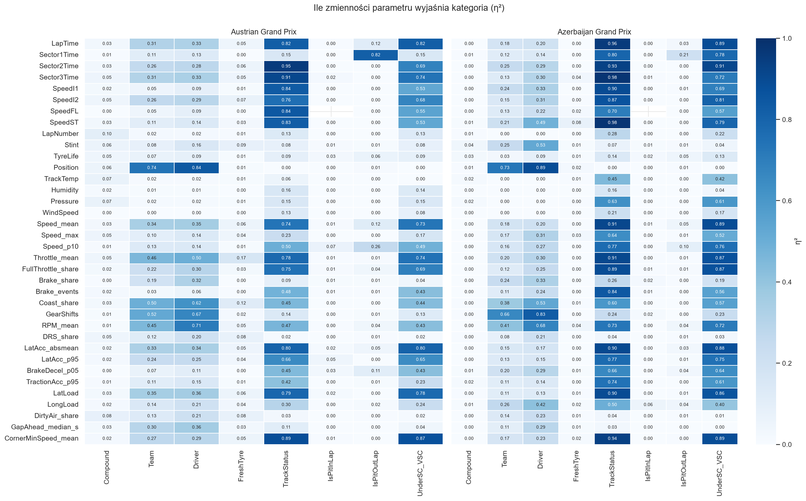

## 8. Telemetria: kanały surowe

Korelacje między próbkami telemetrii, czyli to, co dzieje się wewnątrz okrążenia: bieg ↔ prędkość ok. 0.9, gaz ↔ hamulec ok. −0.7.

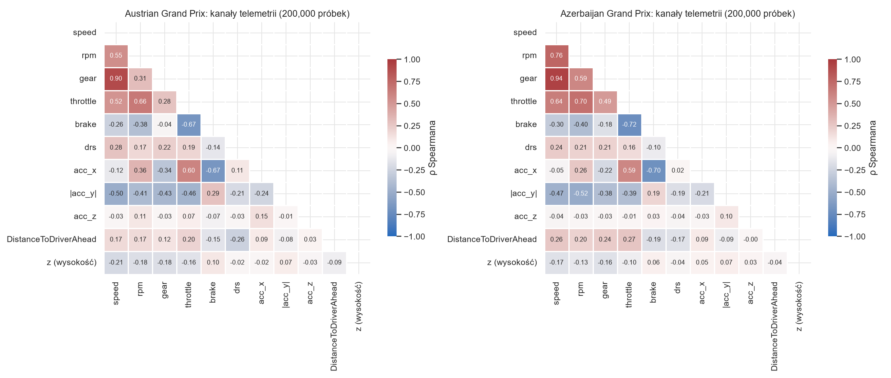

---

Wstępna hipoteza o oponach (degradacja, pit stopy) jest opisana w [Hipotezy i plan modelu](Hipotezy_i_model.md). Nie jest to część głównej analizy.
