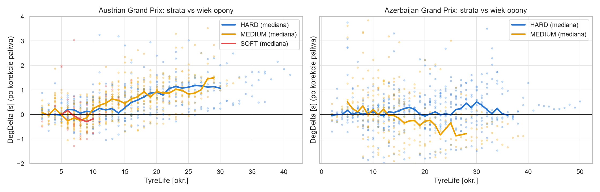
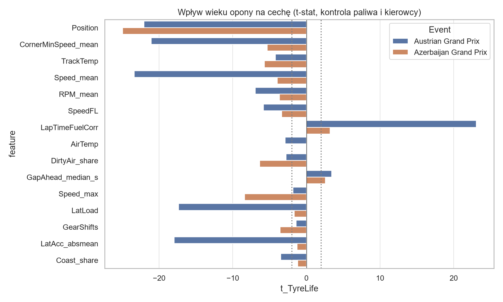
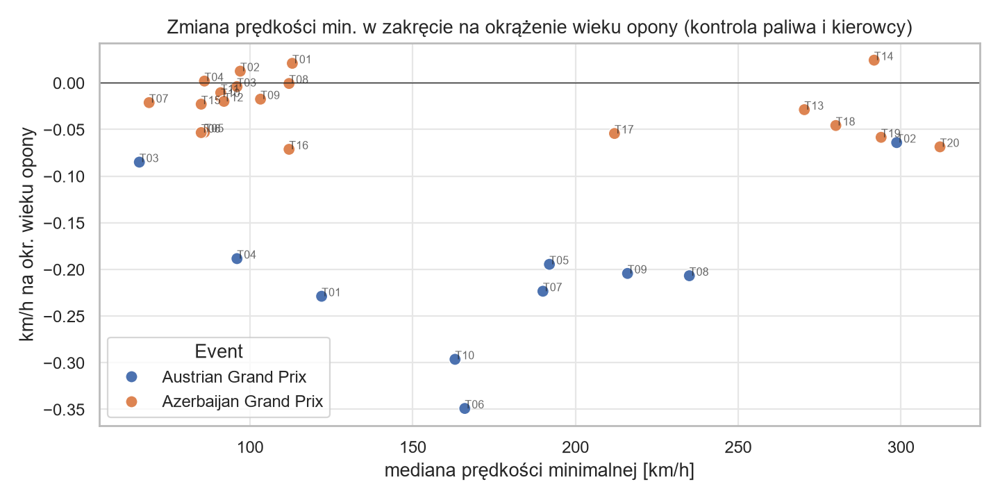
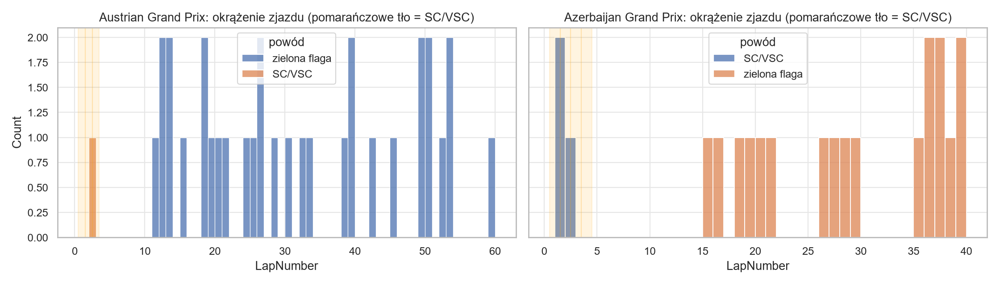
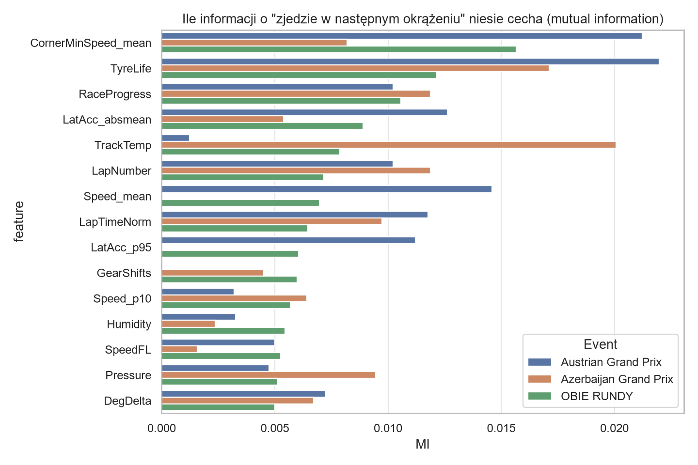

# Hipotezy i plan modelu

← [Wnioski](Wnioski.md) · [Analiza danych](Analiza_danych.md) · [notebook hipotezy opon (archiwum)](../notebooks/archiwum/Opony%20i%20pit%20stopy%20-%20hipoteza%20(v2).ipynb)

Ten plik zbiera to, co **nie jest** neutralną analizą danych: hipotezy, pomysły na model i wstępne wyniki pod konkretny cel. Główna analiza jest w [Analiza_danych.md](Analiza_danych.md).

---

## Hipoteza 1: zużycie opon da się odczytać z danych

**Status:** wstępnie potwierdzona w Austrii, słaba w Baku. Za mało danych (2 wyścigi, 54 pit stopy).

**Jak liczone:** model OLS na czystych okrążeniach, osobno dla każdego toru:
`LapTime ~ LapNumber + C(Compound) + C(Compound):TyreLife + C(Driver)`.
`LapNumber` łapie efekt paliwa, `Compound:TyreLife` to degradacja mieszanki, `C(Driver)` usuwa różnice tempa kierowców. Da się to rozdzielić, bo pit stop zeruje wiek opony, a numer okrążenia rośnie dalej.

**Wyniki (pierwsze uruchomienie, 2 tory, wyścigi 2025):**
- **Degradacja jest wyraźna w Austrii, słaba w Baku.** Austria: ok. +0.05–0.06 s/okr. (MEDIUM i HARD), strata ~1–1.5 s po 25–30 okrążeniach. Baku: HARD ~0.015 s/okr., MEDIUM nieistotna statystycznie. To tor uliczny o niskiej degradacji, gdzie nawierzchnia z każdym okrążeniem staje się szybsza i maskuje zużycie. Model musi znać „charakter toru”.
- **Najlepszy sygnał zużycia z telemetrii: prędkość w zakrętach** (`CornerMinSpeed_mean`, `Speed_mean`, `LatAcc_absmean`). Spada z wiekiem opony po kontroli paliwa i kierowcy, na obu torach w tym samym kierunku: w Austrii bardzo mocno (|t|≈20), w Baku słabiej (|t|≈4–5). Najmocniej w zakrętach średnich i wolnych.
- **Grupy nadmiarowe:** {`Speed_mean`, `CornerMinSpeed_mean`, `LatAcc_absmean`, `LatLoad`}, {`SpeedST`, `Speed_max`}, {`LapNumber`, `RaceProgress`, `TrackTemp`, `Pressure`}. Do modelu po jednej cesze z grupy.
- **Pułapki:** `Position` i `TrackTemp` korelują z wiekiem opony przez cykl pit stopów i upływ czasu. To nie są wskaźniki zużycia.

## Hipoteza 2: z danych da się przewidzieć pit stop

**Status:** raczej nie w tej formie.

- Etykieta `PitNextLap` = kierowca zjedzie na koniec następnego okrążenia (cechy tylko z danych znanych na koniec bieżącego okrążenia).
- Pojedyncze cechy niosą mało informacji (MI ≤ 0.02). Najwięcej: `TyreLife`, prędkość w zakrętach, postęp wyścigu.
- Zjazd zależy od strategii (SC/VSC, okno pit stopu, rywale), a ~54 pit stopy to bardzo mało przykładów.

Pozostałe wykresy: [`Raport/hipoteza_opony/`](../Raport/hipoteza_opony/).

---

## Czy trenowanie modelu ma sens dla naszego celu?

**Krótko: tak, ale w innej formie niż „model mówi, kiedy zjechać”, i na większej liczbie wyścigów.**

### Cel A: „jak najszybciej pokonywać okrążenia”
Model nie poprowadzi auta szybciej. Może za to odpowiedzieć na 2 pytania:
1. **Gdzie traci się czas.** Porównujemy najszybsze i wolniejsze okrążenia zakręt po zakręcie (telemetria to umożliwia). To raczej analiza niż trening modelu, ale daje konkretne, zrozumiałe wyniki.
2. **Jakie tempo jest możliwe w danych warunkach.** Model przewiduje czas okrążenia z rzeczy znanych **przed** okrążeniem: mieszanka, wiek opony, numer okrążenia (paliwo), temperatura, ruch na torze, kierowca i zespół, tor.
   - Uwaga: przewidywanie czasu z prędkości w zakrętach tego samego okrążenia jest prawie oczywiste (to ta sama informacja), więc takiego modelu nie warto robić.

### Cel B: „kiedy zmieniać opony i na jakie”
Sensowna droga ma **2 kroki**:
1. **Model tempa** (regresja): czas okrążenia = f(mieszanka, wiek opony, paliwo, tor, temperatura, kierowca/zespół). To z niego wynika, ile opona traci na okrążenie.
2. **Symulacja strategii:** dla każdej kombinacji „okrążenie zjazdu + mieszanka” liczymy łączny czas wyścigu = suma przewidzianych okrążeń + strata w alei serwisowej (~20 s, do wyliczenia z danych). Wybieramy najkrótszy wariant.
   - W wyścigu na suchym trzeba użyć 2 różnych mieszanek.

**Czego nie robić:** klasyfikatora, który uczy się „czy zespół zjechał w tym okrążeniu”. Mamy 54 przykłady, bardzo duże niezbalansowanie (IR 33–45), a decyzje zespołów zależą od SC i rywali. Taki model kopiowałby decyzje zespołów, zamiast szukać najlepszej strategii.

### Warunki, żeby to miało sens
1. **Więcej wyścigów:** cały sezon 2025, najlepiej także 2024. Wystarczy dopisać rundy do `EVENTS` w notebooku, pobiorą się tylko nowe.
2. **Mapowanie mieszanek:** „SOFT” na każdym torze to inna opona (Pirelli wybiera 3 z C1–C6). Do porównań między torami trzeba dodać tę informację.
3. **Filtr okrążeń:** model tempa uczymy na czystych okrążeniach. SC, pit i 1. okrążenie wyrzucamy albo oznaczamy.
4. **Kierowca/zespół jako zmienna**, bo bez tego model myli „szybkie auto” z „dobrą strategią”.

### Moja rekomendacja
1. Rozszerzyć dane do pełnego sezonu i powtórzyć tę analizę: czy [wnioski 1–6](Wnioski.md) się utrzymują?
2. Zbudować **model tempa** (np. gradient boosting albo regresja z efektami kierowcy). Sprawdzić, czy wiarygodnie przewiduje degradację na nowych torach.
3. Na nim zrobić **symulator strategii** i porównać jego rekomendacje z tym, co zespoły faktycznie zrobiły.
4. Osobno zrobić **analizę „gdzie traci się czas”** na zakrętach. To łatwy i atrakcyjny wynik do prezentacji.
