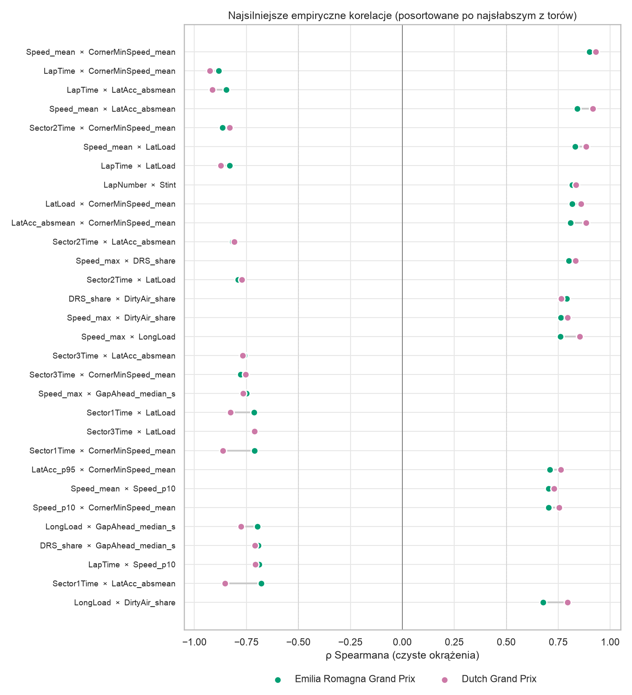
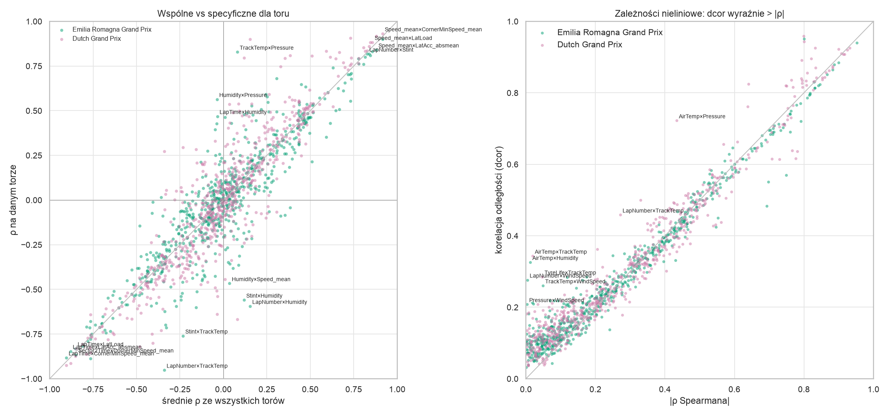
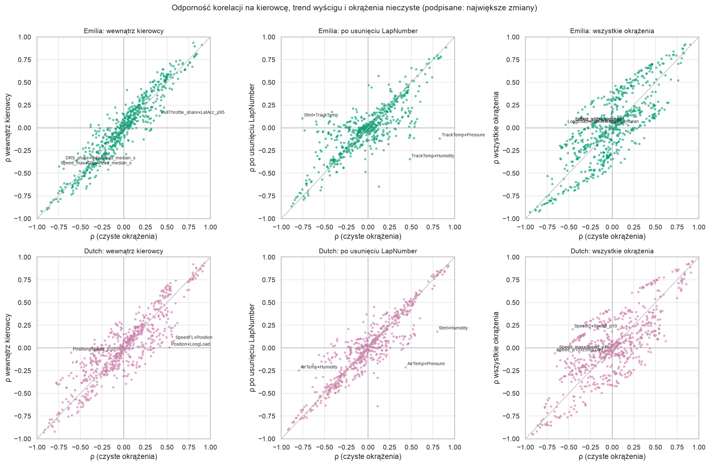
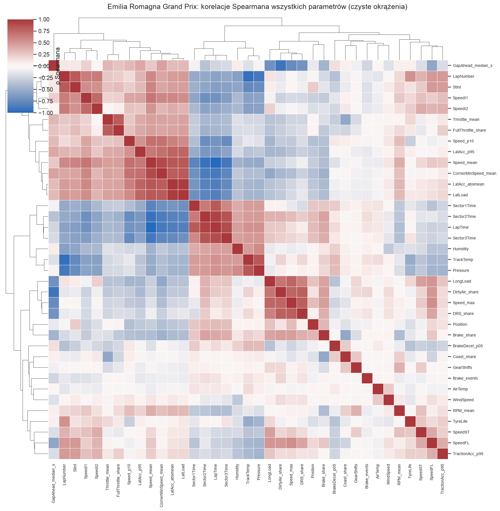
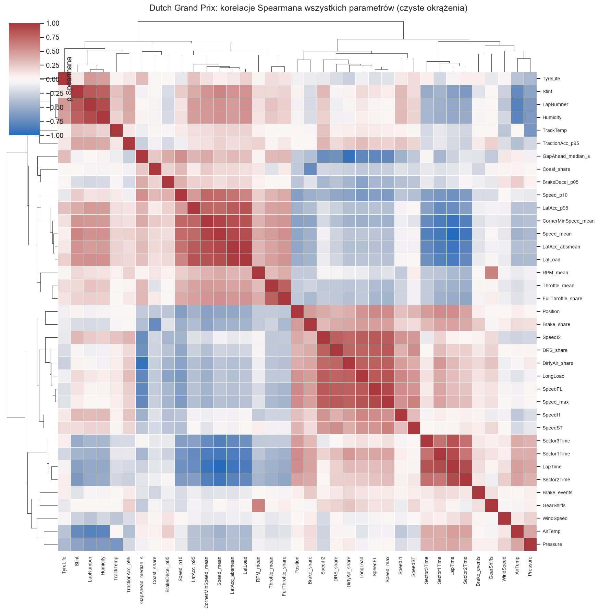

# Emilia Romagna i Dutch GP 2025 — korelacje parametrów (wyścigi)

Notebook: [`notebooks/Analiza korelacji parametrow F1 - Emilia Romagna i Dutch.ipynb`](../../notebooks/Analiza%20korelacji%20parametrow%20F1%20-%20Emilia%20Romagna%20i%20Dutch.ipynb)
Metoda jest taka sama jak w analizie Austrii i Baku (`notebooks/Analiza korelacji parametrow F1 - pelna.ipynb`), ale dane pobiera biblioteka `tif1` (`tif1.get_session(2025, ..., 'Race')`). Zakres: tylko wyścigi, ρ Spearmana na czystych okrążeniach (zielona flaga, bez okrążenia 1 i boksów).

| tor | okrążenia | czyste | pit stopy | okr. SC/VSC | telemetria |
|---|---|---|---|---|---|
| Emilia Romagna | 1207 | 939 | 37 | 207 | 100% okrążeń |
| Dutch | 1364 | 998 | 40 | 277 | 100% okrążeń |

Z 644 par empirycznych 55 ma |ρ| ≥ 0,5 na obu torach z tym samym znakiem. Pełny ranking jest w `pair_ranking.csv` (generuje go notebook; CSV nie trafiają do repo).

## 1. Tempo w zakrętach to najsilniejszy i najbardziej powtarzalny blok

**Co widać** (ρ Emilia / Dutch):
- `LapTime` × `CornerMinSpeed_mean` −0,88 / −0,93
- `LapTime` × `LatAcc_absmean` −0,85 / −0,91
- `Sector2Time` × `CornerMinSpeed_mean` −0,87 / −0,83
- `Speed_mean` × `CornerMinSpeed_mean` 0,90 / 0,93

Zależności zostają wewnątrz kierowcy (`in_driver` ≈ −0,90 i −0,93 dla `LapTime` × `CornerMinSpeed_mean`) i po usunięciu `LapNumber` (`partial_lap` ≈ −0,86 / −0,90).

**Co to znaczy:** szybsze okrążenie to przede wszystkim wyższa prędkość w zakrętach. Nie wynika to tylko z różnic między bolidami. `CornerMinSpeed_mean`, `LatAcc_absmean`, `LatLoad` i `Speed_mean` niosą w dużej mierze tę samą informację (widać je jako jeden blok na mapach klastrów), więc nie należy ich traktować jak niezależnych cech.

**Co dalej:** wybrać po jednym przedstawicielu bloku, jeśli te parametry trafią do modelu.

## 2. Jazda za rywalem: DRS, brudne powietrze i prędkość maksymalna

**Co widać:** `Speed_max` × `DRS_share` 0,80 / 0,83. `DRS_share` × `DirtyAir_share` 0,79 / 0,76. `Speed_max` × `DirtyAir_share` 0,76 / 0,79. Po usunięciu różnic między kierowcami `Speed_max` × `DRS_share` rośnie do 0,94 / 0,88.

**Co to znaczy:** część tej zależności jest z definicji. DRS wolno otworzyć tylko < 1 s za rywalem, więc `DRS_share` i `DirtyAir_share` idą w parze. Wpływ DRS na prędkość maksymalną jest jednak mocny na obu torach.

**Co dalej:** sprawdzić, czy `Speed_max` bez okrążeń z DRS zachowuje zależność z tempem.

## 3. Pogoda zachowuje się inaczej na każdym torze

**Co widać** (ρ Emilia / Dutch):
- `TrackTemp` × `Pressure` +0,83 / −0,67
- `LapNumber` × `TrackTemp` −0,95 / +0,27
- `LapNumber` × `Humidity` −0,59 / +0,90

Pary z parametrami pogody mają najbardziej rozbieżne znaki między torami. Wśród par empirycznych tylko 68% ma ten sam znak na obu torach.

**Co to znaczy:** korelacje pogody z innymi parametrami wynikają głównie z tego, jak pogoda zmieniała się w czasie danego wyścigu (parametry są skorelowane przez `LapNumber`). Nie opisują zależności fizycznej, którą można przenieść na inny tor. Na Emilii tor stygnie przez cały wyścig (ρ = −0,95), na Dutch temperatura toru nie ma wyraźnego trendu (ρ = +0,27).

**Co dalej:** przy łączeniu torów w jeden zbiór traktować pogodę jako cechę specyficzną dla toru albo odjąć trend względem `LapNumber`.

## 4. Wiek opon: surowa korelacja z tempem jest zerowa, po odjęciu przebiegu wyścigu — nie

**Co widać:** `LapTime` × `TyreLife` to 0,01 / −0,06, ale po usunięciu `LapNumber` (`partial_lap`) wychodzi 0,47 / 0,29. `TyreLife` koreluje wprost tylko z `LapNumber` (0,54 / 0,50) i z ciśnieniem (−0,46 / −0,43). Mieszanka (`Compound`) wyjaśnia niewiele zmienności `LapTime` (η² 0,02 / 0,06); największe η² (do 0,35 na Dutch) dotyczy pogody i `Stint`, czyli przebiegu wyścigu.

**Co to znaczy:** kierunek zależności po odjęciu `LapNumber` zgadza się z intuicją (starsze opony, wolniejsze okrążenie), ale to korelacja na poziomie okrążeń. Surowa wartość blisko zera pokazuje, że w trakcie wyścigu działają jednocześnie inne efekty. To obserwacja z danych, a nie test hipotezy o oponach.

**Co dalej:** sprawdzić to na poziomie jednego stintu (zmiana tempa względem pierwszego okrążenia stintu) i na większej liczbie wyścigów.

## 5. Zależności nieliniowe

**Co widać:** największą różnicę dcor − |ρ| mają pary z pogodą: `AirTemp` × `TrackTemp` (Dutch, ρ −0,02, dcor 0,34), `AirTemp` × `Humidity` (Emilia, ρ −0,01, dcor 0,33), `AirTemp` × `Pressure` (Dutch, ρ 0,43, dcor 0,72).

**Co to znaczy:** są to zależności, których Spearman nie widzi. Są jednak słabe (dcor ≤ 0,34), poza `AirTemp` × `Pressure`. Wśród par z tempem okrążenia nie ma takiej zależności.

## Zastrzeżenia

- Okrążenia jednego kierowcy nie są niezależne, więc p-wartości są optymistyczne. Ważniejsze są siła i powtarzalność na obu torach.
- Dwa tory to za mało, żeby mówić o regule. Zgodność znaku na dwóch torach nie jest dowodem.
- Dane przeszły przez `tif1` zamiast przez własny parser (Austria i Baku). Cechy telemetrii liczy ta sama funkcja, ale próbki telemetrii mogą się różnić od surowych JSON-ów. Nie porównywałem tego na tym samym torze.

