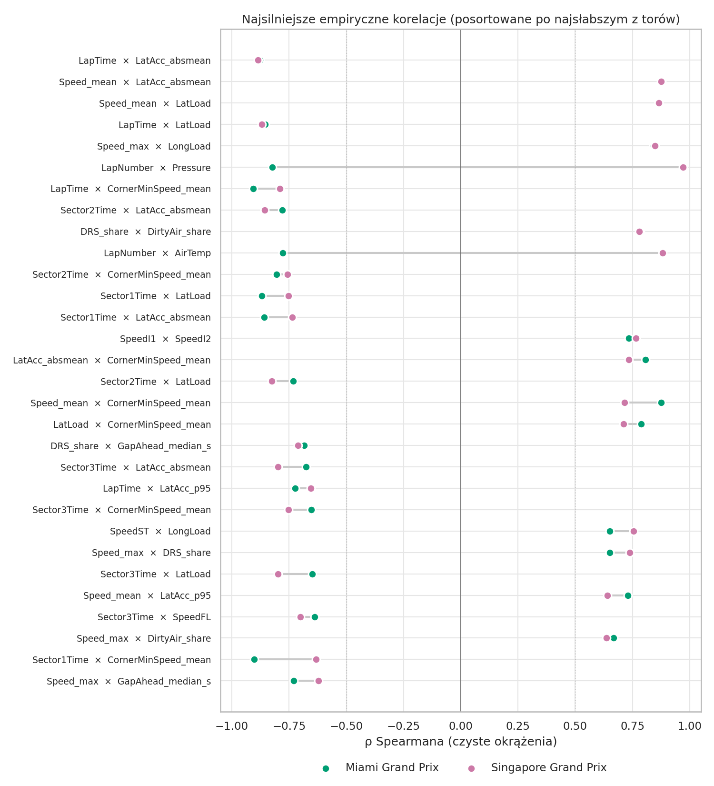
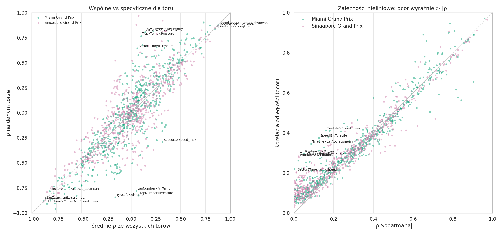
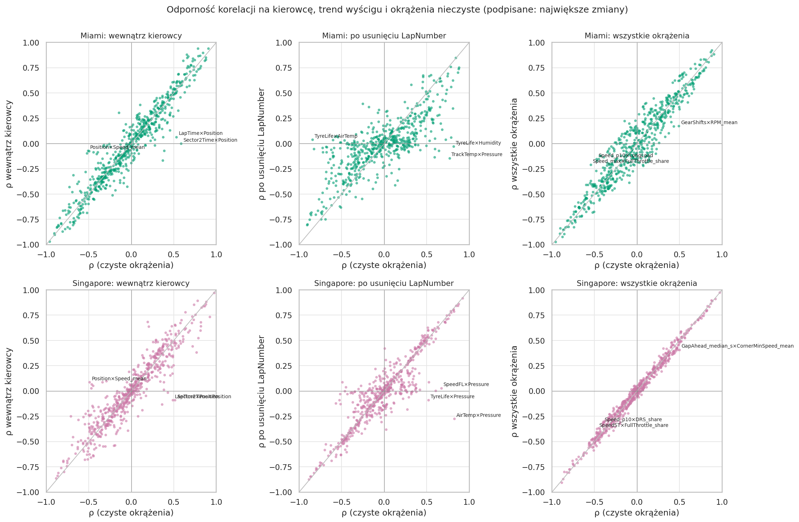
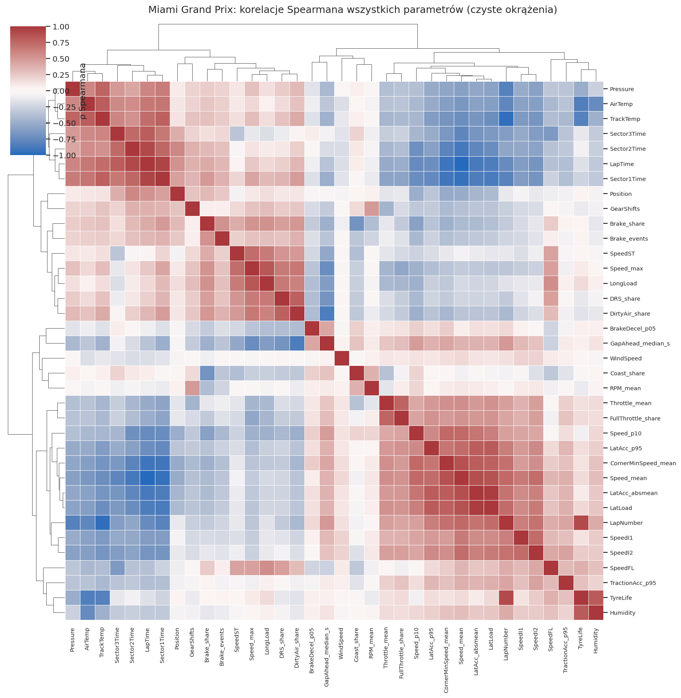
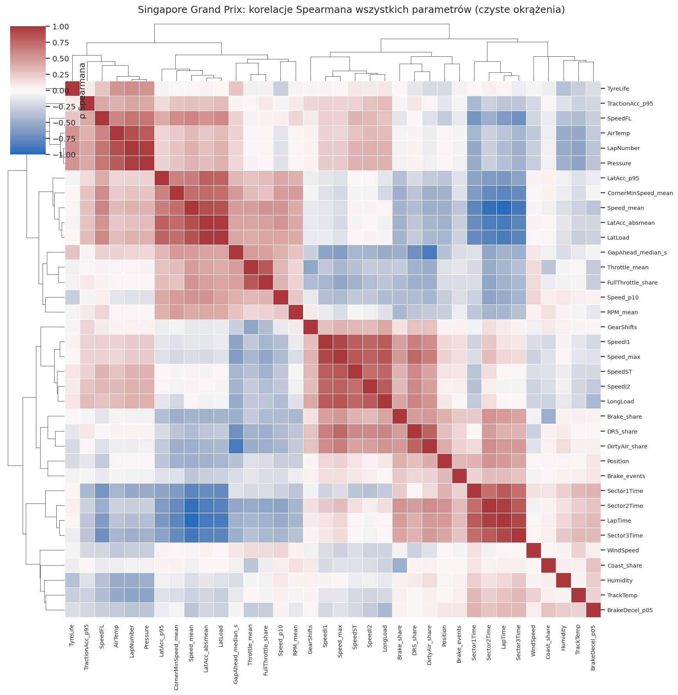

# Miami i Singapore GP 2025 — korelacje parametrów (wyścigi)

Notebook: [`notebooks/Analiza korelacji parametrow F1 - Miami i Singapore.ipynb`](../../notebooks/Analiza%20korelacji%20parametrow%20F1%20-%20Miami%20i%20Singapore.ipynb)
Metoda jest taka sama jak w analizie Emilii Romagna i Dutch. Zakres: tylko wyścigi, ρ Spearmana na czystych okrążeniach (zielona flaga, bez okrążenia 1 i boksów).

| tor | okrążenia | czyste | pit stopy | okr. SC/VSC | telemetria |
|---|---|---|---|---|---|
| Miami | 1005 | 856 | 19 | 104 | 100% okrążeń |
| Singapore | 1229 | 1105 | 23 | 0 | 100% okrążeń |

Z 608 par empirycznych 49 ma |ρ| ≥ 0,5 na obu torach z tym samym znakiem. Pełny ranking jest w `pair_ranking.csv` (generuje go notebook; CSV nie trafiają do repo). Pary „definicyjne" (np. `LapTime` × `Speed_mean`, ρ −0,99 / −0,99, albo `LatAcc_absmean` × `LatLoad`) są liczone osobno i nie wchodzą do tych 608.

## 1. Tempo w zakrętach to najsilniejszy i najbardziej powtarzalny blok

**Co widać** (ρ Miami / Singapore):
- `LapTime` × `LatAcc_absmean` −0,88 / −0,89
- `LapTime` × `LatLoad` −0,85 / −0,87
- `LapTime` × `CornerMinSpeed_mean` −0,91 / −0,79
- `Sector2Time` × `CornerMinSpeed_mean` −0,80 / −0,76
- `Speed_mean` × `CornerMinSpeed_mean` 0,87 / 0,71
- `Speed_mean` × `LatAcc_absmean` 0,88 / 0,88

Zależności zostają wewnątrz kierowcy (`in_driver` dla `LapTime` × `CornerMinSpeed_mean` −0,89 / −0,80, dla `LapTime` × `LatAcc_absmean` −0,83 / −0,86) i po usunięciu `LapNumber` (`partial_lap` −0,81 / −0,77 oraz −0,75 / −0,87).

**Co to znaczy:** szybsze okrążenie to przede wszystkim wyższa prędkość w zakrętach, i nie wynika to tylko z różnic między bolidami ani z przebiegu wyścigu. `CornerMinSpeed_mean`, `LatAcc_absmean`, `LatLoad` i `Speed_mean` niosą w dużej mierze tę samą informację (widać je jako jeden blok na mapach klastrów, opis na końcu), więc nie należy ich traktować jak niezależnych cech. W Singapore związek z `CornerMinSpeed_mean` jest słabszy niż w Miami (−0,79 wobec −0,91), a z `LatAcc_absmean` taki sam.

**Co dalej:** wybrać po jednym przedstawicielu bloku, jeśli te parametry trafią do modelu.

## 2. Jazda za rywalem: DRS, brudne powietrze i prędkość maksymalna

**Co widać:** `DRS_share` × `DirtyAir_share` 0,78 / 0,78. `Speed_max` × `DRS_share` 0,65 / 0,74. `Speed_max` × `DirtyAir_share` 0,67 / 0,64. Po usunięciu różnic między kierowcami `Speed_max` × `DRS_share` rośnie do 0,88 / 0,85, a `DRS_share` × `DirtyAir_share` do 0,94 / 0,90. Dodatkowo `DRS_share` × `GapAhead_median_s` −0,68 / −0,71, ale wewnątrz kierowcy tylko −0,31 / −0,25.

**Co to znaczy:** część tej zależności jest z definicji. DRS wolno otworzyć tylko < 1 s za rywalem, więc `DRS_share` i `DirtyAir_share` idą w parze. Wpływ DRS na prędkość maksymalną jest mocny na obu torach, a różnice między kierowcami go osłabiają (surowe 0,65 / 0,74 wobec 0,88 / 0,85 w obrębie kierowcy). Związek `DRS_share` z odstępem do rywala jest w dużej mierze efektem różnic między kierowcami, bo wewnątrz kierowcy prawie znika.

**Co dalej:** sprawdzić, czy `Speed_max` bez okrążeń z DRS zachowuje zależność z tempem. Surowe `LapTime` × `Speed_max` to tylko 0,26 / 0,18.

## 3. Pogoda zachowuje się inaczej na każdym torze

**Co widać** (ρ Miami / Singapore):
- `LapNumber` × `Pressure` −0,82 / +0,97
- `LapNumber` × `AirTemp` −0,78 / +0,88
- `LapNumber` × `TrackTemp` −0,96 / −0,56
- `AirTemp` × `TrackTemp` +0,81 / −0,53
- `TrackTemp` × `Pressure` +0,77 / −0,57

Pary z parametrami pogody mają najbardziej rozbieżne znaki między torami: wśród 165 par empirycznych z pogodą ten sam znak na obu torach ma 43%, wśród pozostałych 74%. Dla wszystkich par empirycznych jest to 65%.

**Co to znaczy:** korelacje pogody z innymi parametrami wynikają głównie z tego, jak pogoda zmieniała się w czasie danego wyścigu (parametry są skorelowane przez `LapNumber`). Nie opisują zależności fizycznej, którą można przenieść na inny tor. W Miami tor stygnie przez cały wyścig (ρ = −0,96), a powietrze też (−0,78). W Singapore temperatura powietrza i ciśnienie rosną z okrążeniami (+0,88 i +0,97), a tor stygnie słabiej (−0,56). Dowód, że to artefakt czasu: po usunięciu `LapNumber` (`partial_lap`) np. `TrackTemp` × `Pressure` spada z +0,77 / −0,57 do −0,14 / −0,12.

**Co dalej:** przy łączeniu torów w jeden zbiór traktować pogodę jako cechę specyficzną dla toru albo odjąć trend względem `LapNumber`.

## 4. Wiek opon: surowa korelacja z tempem jest słaba, po odjęciu przebiegu wyścigu zmienia znak

**Co widać:** `LapTime` × `TyreLife` to −0,18 / +0,02, ale po usunięciu `LapNumber` (`partial_lap`) wychodzi +0,36 / +0,31. `TyreLife` koreluje wprost z `LapNumber` (0,90 / 0,55) i z pogodą, ale ta druga zależność znika po odjęciu `LapNumber` (np. `TyreLife` × `AirTemp` −0,84 / +0,52 surowo, +0,04 / +0,09 po odjęciu). Mieszanka (`Compound`) wyjaśnia mało zmienności `LapTime` (η² 0,005 w Miami, 0,10 w Singapore), podczas gdy `Driver` (0,34 / 0,32) i `Team` (0,25 / 0,26) wyjaśniają dużo więcej.

**Co to znaczy:** kierunek zależności po odjęciu `LapNumber` zgadza się z intuicją (starsze opony, wolniejsze okrążenie), ale to korelacja na poziomie okrążeń. Surowa wartość blisko zera lub ujemna pokazuje, że w trakcie wyścigu działają jednocześnie inne efekty, przede wszystkim spalanie paliwa (`LapTime` × `LapNumber` −0,75 / −0,39). To obserwacja z danych, a nie test hipotezy o oponach.

**Uwaga o danych:** w Miami `TyreLife` i `Stint` mają 44,4% braków, więc pary z tymi parametrami liczone są na 478 okrążeniach, a nie na 856. W Singapore braków nie ma. Wynik dla Miami jest przez to mniej pewny i nie jest w pełni porównywalny z Singapore.

**Co dalej:** sprawdzić to na poziomie jednego stintu (zmiana tempa względem pierwszego okrążenia stintu), uzupełnić braki `TyreLife` w Miami i sprawdzić większą liczbę wyścigów.

## 5. Zależności nieliniowe

**Co widać:** największą różnicę dcor − |ρ| (wykres po prawej na `tracks_and_nonlinear.png`) mają:
- `TrackTemp` × `Humidity` (Singapore, ρ 0,02, dcor 0,28)
- `Humidity` × `WindSpeed` (Singapore, ρ 0,02, dcor 0,28)
- `TyreLife` × `LatAcc_absmean` (Miami, ρ 0,09, dcor 0,34)
- `TyreLife` × `Speed_mean` (Miami, ρ 0,16, dcor 0,41)
- `LapTime` × `TyreLife` (Miami, ρ −0,18, dcor 0,41)

**Co to znaczy:** są to zależności, których Spearman nie widzi, ale wszystkie poza parami z `TyreLife` w Miami są słabe (dcor ≤ 0,34). W odróżnieniu od analizy Emilii i Dutch wśród par z tempem okrążenia jest jedna taka zależność: `LapTime` × `TyreLife` w Miami. Jej niemonotoniczny kształt pasuje do obserwacji z sekcji 4, ale trzeba pamiętać, że liczona jest na 478 okrążeniach.

## Zastrzeżenia

- Okrążenia jednego kierowcy nie są niezależne, więc p-wartości są optymistyczne. Ważniejsze są siła i powtarzalność na obu torach.
- Dwa tory to za mało, żeby mówić o regule. Zgodność znaku na dwóch torach nie jest dowodem. Miami (tor uliczno-hybrydowy) i Singapore (uliczny, nocny) różnią się też od siebie warunkami bardziej niż Emilia i Dutch.
- Singapore ma 0 okrążeń SC/VSC, a Miami 104. Dlatego w Singapore wyniki dla czystych i wszystkich okrążeń są prawie identyczne (prawy dolny panel `correlation_robustness.png`), a w Miami filtrowanie ma większe znaczenie. Różnice między torami częściowo wynikają więc z samego przebiegu wyścigu.
- Parametry `Stint` i `Rainfall` nie weszły do analizy (`w_analizie = False` w `parameter_catalog.csv`).
- Wartości η² w `categorical_eta2.csv` obejmują również kategorie typu `TrackStatus` i `UnderSC_VSC` (w Miami do 0,84 dla `LapTime`), które z definicji oddzielają okrążenia neutralizacji od czystych. Nie należy ich interpretować jak wpływu mieszanki czy kierowcy.

## Mapy klastrów

Mapy pokazują ρ Spearmana wszystkich parametrów na czystych okrążeniach, pogrupowane hierarchicznie. Mapy dla obu torów dzielą parametry na podobne bloki, ale nie identyczne.

**Co widać:**
- **Blok zakrętów** jest na obu mapach i zawiera `CornerMinSpeed_mean`, `LatAcc_absmean`, `LatAcc_p95`, `LatLoad` i `Speed_mean`. Dochodzą do niego `Speed_p10`, `Throttle_mean` i `FullThrottle_share` (w Singapore także `GapAhead_median_s` i `RPM_mean`). `LapTime` i czasy sektorów mają z tym blokiem silną korelację ujemną, więc to właśnie tu leży wyjaśnienie tempa. Potwierdza to sekcję 1.
- **Blok prostych i DRS** to `Speed_max`, `SpeedST`, `LongLoad`, `DRS_share` i `DirtyAir_share`, w Singapore także `SpeedI1` i `SpeedI2`, a w obu `Brake_share` w słabszej korelacji (np. `Brake_share` × `DRS_share` 0,47 / 0,47). Jest to osobny klaster niż blok zakrętów: `Speed_max` × `Speed_mean` to tylko −0,30 / −0,20, a `Speed_max` × `LongLoad` 0,84 / 0,85. `Speed_mean` nie należy więc do tego samego bloku co `Speed_max`.
- **Parametry czasu** (`LapNumber`, pogoda, `TyreLife`) grupują się inaczej na każdym torze, co zgadza się z sekcją 3. W Singapore tworzą własny blok (`AirTemp`, `LapNumber`, `Pressure`, `SpeedFL`, `TyreLife`), oddzielony od `LapTime`. W Miami `LapNumber` trafia do bloku zakrętów (ρ z `Speed_mean` 0,75, z `CornerMinSpeed_mean` 0,70; w Singapore 0,37 i 0,28), a `LapTime` ląduje w jednym klastrze z pogodą (`TrackTemp` 0,72, `Pressure` 0,60). W Singapore te same pary dają 0,29 i −0,38.

**Co to znaczy:** w Miami prędkości w zakrętach rosną z kolejnymi okrążeniami (spalanie paliwa, mniej gumy), a pogoda zmienia się razem z `LapNumber`, więc `LapTime` wygląda na związane z pogodą. To ten sam mechanizm, który w sekcji 3 powoduje rozbieżne znaki, i nie należy go czytać jako wpływu pogody na tempo.

**Co dalej:** przy wyborze reprezentantów bloków (sekcja 1) trzeba wziąć po jednym z bloku zakrętów i jednym z bloku prostych/DRS, a nie dwa z tego samego.
